# 部署舱用户使用说明书

适用版本：0.3.20　　更新日期：2026-10-28

## 关于本手册

本手册面向使用部署舱完成 Docker Compose 项目部署、更新与日常运维的操作人员，按“准备环境、建立项目、获取制品、执行部署、观察运行”的顺序说明界面入口、操作步骤和判断依据。

书中界面取自 0.3.20 版本的桌面应用，操作环境为一套正在运行的局域网部署。为避免暴露内部信息，示例截图中的主机地址、个人目录与组织标识已做模糊处理，其余内容保持界面原样。当界面与本手册描述不一致时，以应用实际显示和提示为准。

### 阅读约定

- 「」中的文字表示界面上的按钮、菜单、字段或页面名称，例如「部署向导」「执行预检」。
- 灰色说明文字表示补充信息或风险提示，操作前应阅读。
- 涉及修改目标机的操作，正文都会说明影响范围；未说明影响范围的操作仅读取或展示数据。

## 一、产品概览

部署舱是一款桌面端部署助手，把交付包分发、容器编排、镜像准备和运行诊断集中到一个界面中。它不负责构建应用，而是按交付包内的描述文件执行部署，因此同一份交付包可以在本机或远程服务器上还原出同样的服务结构。

### 1.1 主要能力

| 能力 | 入口 | 说明 |
| --- | --- | --- |
| 项目管理 | 「项目管理」 | 一个项目对应一台主机、一个部署目录和一个制品源 |
| 连接管理 | 「凭证管理」「主机管理」 | 维护可复用的 SSH 登录身份与部署目标 |
| 主机检查 | 主机卡片「状态」 | 查看系统资源、Docker、Compose 与端口占用 |
| 获取交付包 | 「制品中心」 | 从流水线或直链下载、校验并缓存交付包 |
| 部署与更新 | 「部署向导」 | 六步核对后执行首次部署或增量更新 |
| 运行观察 | 项目卡片「监控」「日志」 | 查看容器健康状态与容器日志 |
| 镜像准备 | 「镜像与离线包」 | 拉取、导出、导入镜像，向目标机分发离线包 |
| 自动化接入 | 「MCP 服务」 | 让支持 MCP 的 AI 助理读取项目资料并协助操作 |

### 1.2 两层结构

部署舱由桌面应用与可选的 MCP 服务两部分组成。桌面应用负责实际的下载、校验、传输和部署；MCP 服务由 AI 助理启动，读取同一份项目与制品配置后调用相同的能力。不使用 AI 助理时无需配置 MCP，桌面端的全部功能不受影响。

### 1.3 使用前提

- 运行部署舱的电脑需要已安装 Docker；本机部署还要求 Docker 服务正在运行，并具备 Compose。
- 远程主机需要开启 SSH，并允许使用密钥登录。应用只记录私钥路径，不复制私钥内容。
- 部署目标需要足够的磁盘空间，用于存放交付包、应用产物和镜像。
- 交付包由目标项目流水线产出；离线环境需要提前准备基础镜像和 Docker 安装介质。

## 二、安装与首次启动

### 2.1 获取安装包

从项目的 GitHub Releases 页面下载与操作系统匹配的安装包：

| 平台 | 安装包 |
| --- | --- |
| macOS（Apple Silicon） | DMG |
| Windows | NSIS 或 MSI |
| Linux | AppImage 或 DEB |

当前发布流程不提供 macOS Intel 安装包。安装完成后首次打开应用，窗口标题为「部署舱」，左下角显示运行方式与版本号。

### 2.2 启动时的 Docker 检查

应用启动后会检查本机是否安装 Docker。此检查只读取安装位置和命令版本，不判断 Docker 服务是否已经启动。

未检测到 Docker 时会出现提示，可选择的处理方式：

- 「安装 Docker」：在默认浏览器打开对应系统的官方安装页面。打开网页不代表安装完成。
- 「稍后处理」：关闭提示，继续使用应用的其他功能。
- 「重新检测」：完成安装后返回应用，重新检查。

只有重新检测到 Docker 后提示才会消失。即使本机未安装 Docker，仍然可以为远程主机准备部署，但部署前的环境检查会按所选目标重新判断。

### 2.3 界面布局

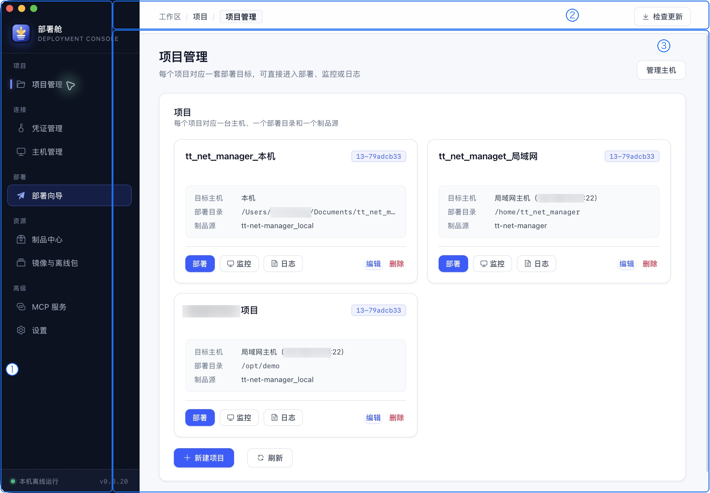

界面分为三部分，图中编号与下文一致：

1. 左侧导航：按「项目」「连接」「部署」「资源」「高级」分组，进入各功能页面。底部显示本机运行方式与版本号。
2. 顶部面包屑：显示当前所在分组与页面，右侧「检查更新」用于获取新版本。
3. 主内容区：当前页面的列表、表单或向导内容。

### 2.4 常用术语

| 术语 | 含义 |
| --- | --- |
| 项目 | 一套部署目标，由主机、部署目录和制品源组成 |
| 主机 | 部署执行的位置，分为「本机」与「远程主机（SSH）」 |
| 部署目录 | 目标机上的安装根目录，交付包内容按声明写入其下 |
| 部署配置 | 交付包中 Compose 清单所在目录，通常是部署目录下的 `deploy` |
| 交付包 | 包含描述文件与产物的压缩包，是部署的唯一输入 |
| 制品源 | 交付包的来源，支持云效流水线与 HTTPS 直链 |
| 组件 | 交付包声明的更新单元，增量更新时按组件勾选 |
| 清单比对 | 将包内 Compose 清单与目标机现有清单比较的过程 |
| 预检 | 执行前的只读检查，不替换文件、不创建备份、不重启服务 |
| 首次部署 | 向空的部署目录写入交付包并启动服务 |
| 增量更新 | 对已有部署按组件替换文件并重启受影响的服务 |

## 三、快速开始

以下流程概括从零到一次成功部署的完整路径，各步骤的细节见后续章节。

1. 在「主机管理」确认本机或新增远程主机，并用「状态」检查环境。
2. 在「凭证管理」准备 SSH 登录身份；远程主机需要绑定凭证。
3. 在「项目管理」新建项目，选择主机、填写部署目录、选择制品源。
4. 在「制品中心」选择制品源与版本，下载并校验交付包。
5. 从项目卡片点「部署」进入向导，依次完成选择项目、检测环境、选择制品、解压制品、清单比对、选择更新。
6. 执行完成后回到「监控」和「日志」确认容器状态与运行输出。

生产环境与测试环境应分别建立项目，避免在同一部署目录上反复切换版本。

## 四、项目管理

项目把“部署到哪里、用什么制品”固定下来。部署、监控、日志都会使用当前项目绑定的主机与部署目录。

### 4.1 项目列表

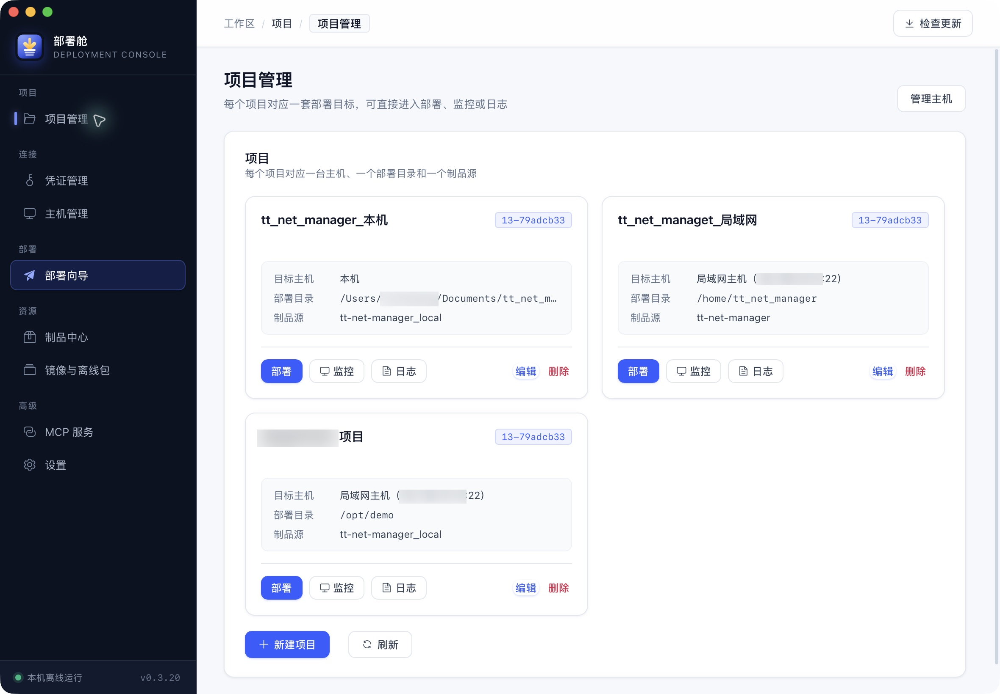

每张项目卡片显示四项信息：项目名称、交付包产品与最近版本、目标主机、部署目录和制品源。卡片底部提供四个操作：

- 「部署」：带着该项目进入部署向导。
- 「监控」：查看该项目的容器健康状态与运行指标。
- 「日志」：查看该项目核心服务的容器日志。
- 「编辑」「删除」：修改绑定关系，或移除项目记录。

删除项目只移除记录，不删除已下载的交付包，也不改动目标机上的文件。删除前需要确认没有部署任务正在使用该项目。

### 4.2 新建与编辑项目

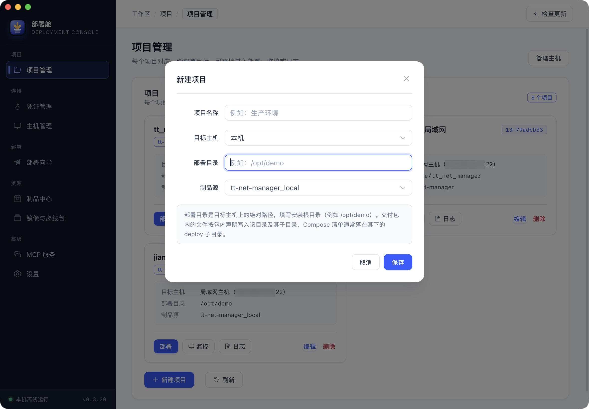

点击「新建项目」后填写：

| 字段 | 说明 |
| --- | --- |
| 项目名称 | 必填，用于区分不同环境，建议写明用途，例如“生产环境” |
| 目标主机 | 从主机管理中选择；本机与远程主机使用同一入口 |
| 部署目录 | 必填，目标机上的绝对路径，填写安装根目录而不是清单所在目录 |
| 制品源 | 从制品设置中选择，决定交付包从哪里获取 |

弹窗下方的说明指出：交付包内的文件按包内声明写入部署目录及其子目录，Compose 清单通常落在其下的 `deploy` 子目录。如果把清单目录误填为部署目录，向导的环境检测与清单比对会指出实际清单位置，并提示应填写的上级目录。

编辑项目时可以调整名称、主机、部署目录和制品源。更换制品源不会删除已下载的交付包；更换主机后，监控、日志与数据库都会转向新主机。

## 五、凭证与主机

### 5.1 凭证管理

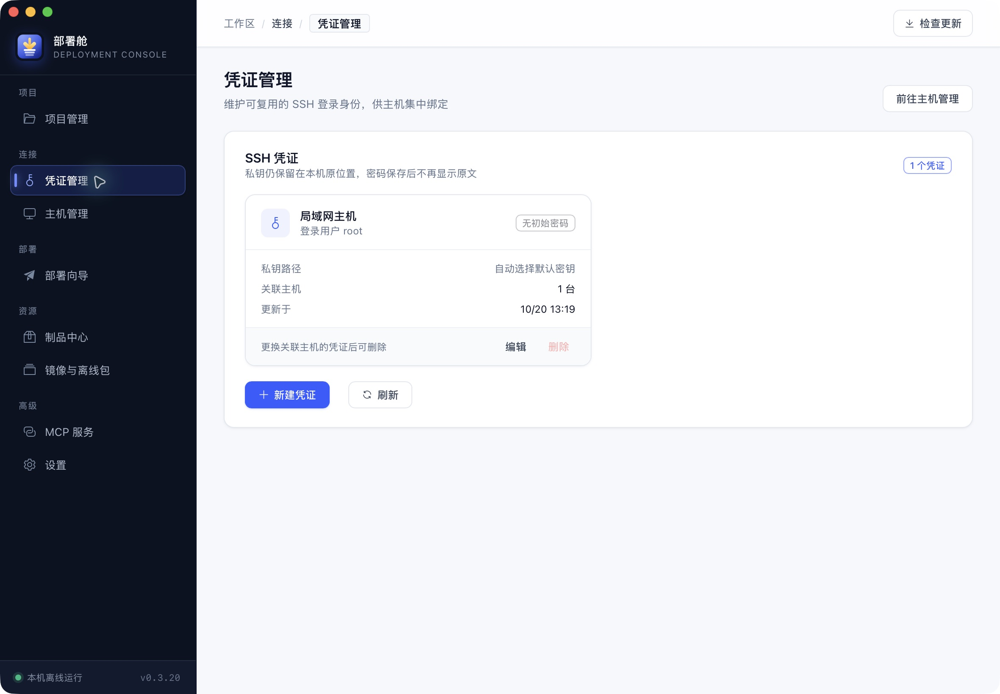

凭证保存 SSH 登录身份，供多台主机复用。列表显示凭证名称、登录用户、私钥路径、关联主机数量与更新时间。

- 私钥保留在本机原位置，应用只记录路径，不复制私钥内容。
- 列表不会回显初始密码；保存后仅显示“有无初始密码”。
- 仍被主机使用的凭证不能删除，需要先更换关联主机的凭证。

### 5.2 新建凭证

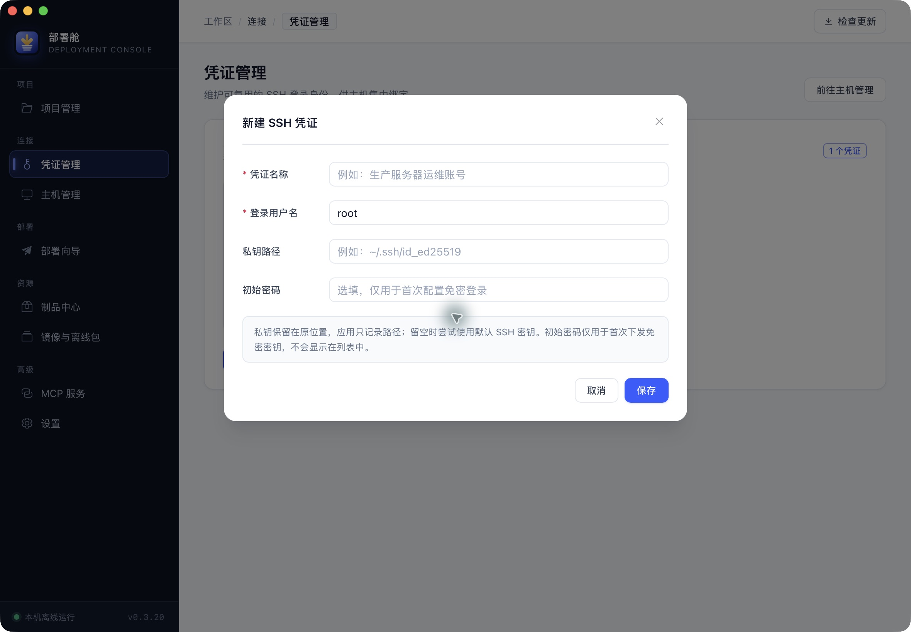

| 字段 | 说明 |
| --- | --- |
| 凭证名称 | 必填，建议写明账号用途，便于在主机列表中辨认 |
| 登录用户名 | 必填，例如 `root` |
| 私钥路径 | 可填写 `~/.ssh/id_ed25519` 形式；留空时尝试使用默认密钥 |
| 初始密码 | 选填，仅用于首次下发免密公钥，配置完成后可清除 |

初始密码只在首次配置免密登录时使用，不会显示在列表中，也不会写入日志。已经在目标机安装过公钥的环境无需填写。

### 5.3 主机管理

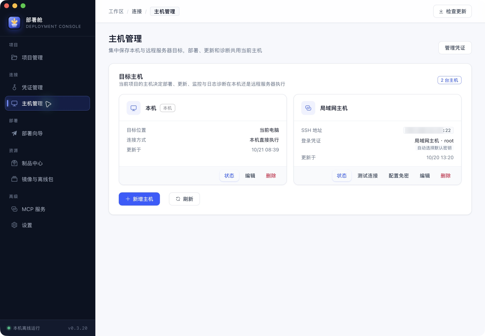

主机分为两类：

- 本机：运行部署舱的当前电脑，不需要地址与凭证，显示“本机直接执行”。
- 远程主机：保存 SSH 地址、端口和绑定凭证，可执行「测试连接」「配置免密」。

常用操作：

- 「状态」：进入主机状态页，检查资源、Docker、Compose 与端口。
- 「测试连接」：验证当前凭证能否登录目标主机。
- 「配置免密」：生成或下发公钥，避免每次输入密码。
- 「新增主机」：添加本机或远程主机。

主机只保存连接信息，部署目录由项目维护，因此同一台主机可以服务多个项目。

### 5.4 新增主机

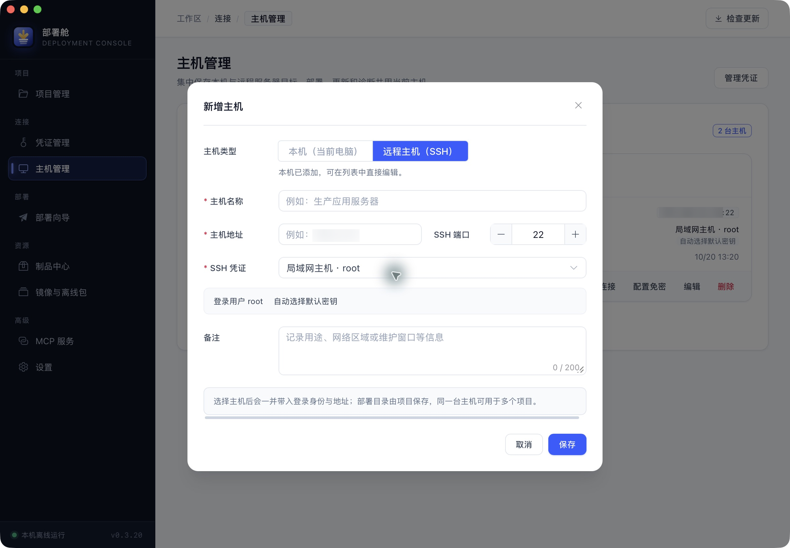

选择「远程主机（SSH）」后填写主机名称、主机地址与 SSH 端口，并选择已保存的凭证。备注用于记录用途、网络区域或维护窗口，最多 200 个字符。

本机类型在同一台电脑上只需添加一次；已存在本机时该选项不可再次选择，可在列表中直接编辑。

## 六、主机状态

主机状态用于在执行部署前确认目标环境是否具备条件。

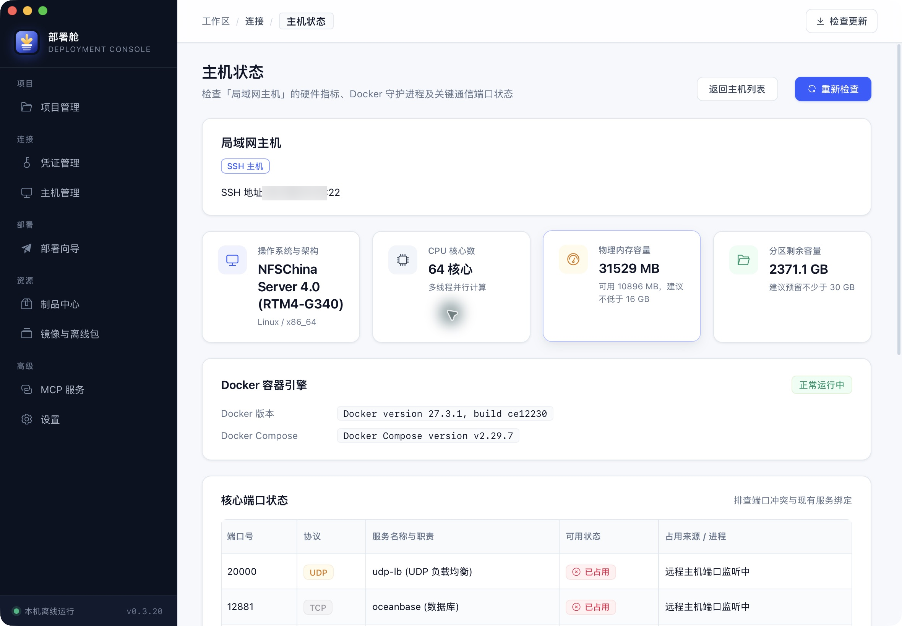

页面上方显示主机类型、SSH 地址，以及四项指标：

| 指标 | 关注点 |
| --- | --- |
| 操作系统与架构 | 与交付包镜像的架构是否一致 |
| CPU 核心数 | 影响并行构建与服务启动速度 |
| 物理内存容量 | 显示总量与可用量，建议不低于 16 GB |
| 分区剩余容量 | 建议预留不少于 30 GB，用于产物与镜像 |

下方的「Docker 容器引擎」显示 Docker 与 Compose 版本以及运行状态；未运行时无法继续部署。页面底部按交付包声明的服务端口逐个检查占用情况。

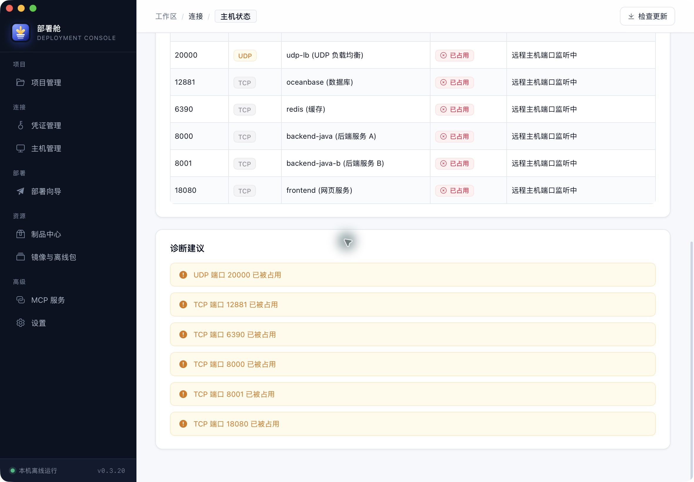

端口已被占用时显示“已占用”并给出占用来源。对于已有部署的目标机，端口被本项目的容器占用属于正常现象；如果是其他程序占用，需要先释放端口或调整部署配置，否则新服务无法启动。

底部「诊断建议」逐条列出需要处理的端口。点击「重新检查」可再次采集数据，检查过程只读取信息，不修改目标机。

## 七、制品中心

### 7.1 选择制品源

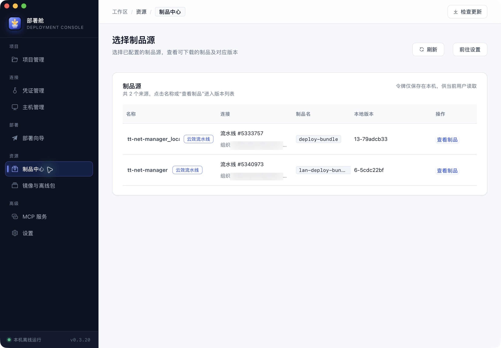

制品中心先列出在「设置 → 制品设置」中配置的来源，每行显示来源名称、连接方式、制品名与本地最近版本。点击来源名称或「查看制品」进入版本列表。

访问令牌仅保存在本机应用数据目录，只用于拉取流水线版本与下载交付包，不会写入交付包或部署记录。

### 7.2 版本列表

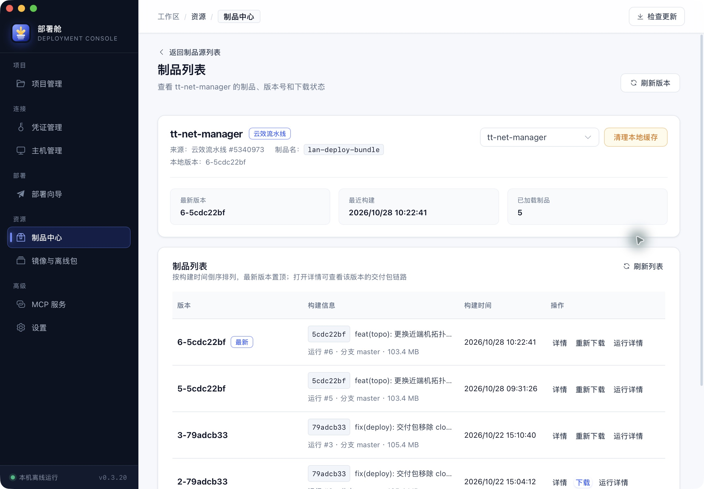

版本按构建时间倒序排列，最新版本置顶。顶部汇总最新版本、最近构建时间与已加载制品数量。每行显示版本号、提交摘要、运行编号、分支、包大小与构建时间，并提供：

- 「详情」：查看该版本的构建信息与交付包链路。
- 「下载」或「重新下载」：获取并解压该版本。
- 「运行详情」：打开流水线运行页面查看构建日志。

网络不可用时页面会保留上次成功获取的版本列表与已下载的交付包，并在刷新时提示连接失败；恢复连接后刷新即可重新获取。

### 7.3 版本详情

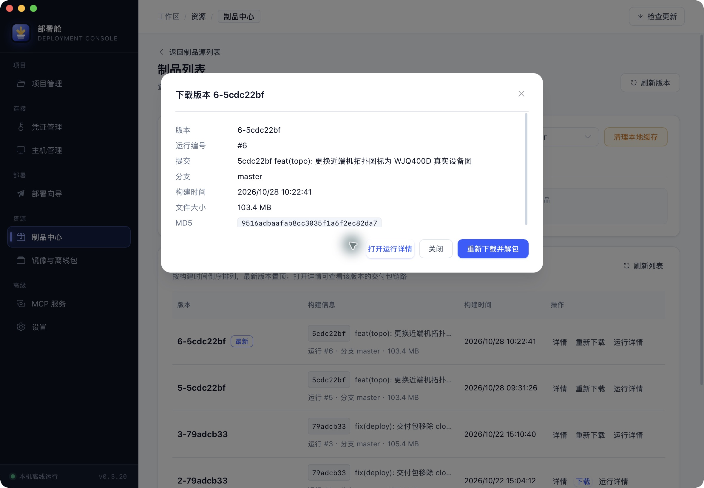

详情窗口显示版本号、运行编号、提交说明、分支、构建时间、文件大小与 MD5。下载时会依次校验来源摘要、压缩包路径安全、包结构、描述符与包内版本；任一环节失败都不会覆盖已存在的本地交付包。

同一个版本下载完成后，按钮变为「重新下载并解包」；已经下载的版本可以直接进入部署向导，无需再次下载。

## 八、部署向导

部署向导由六个步骤组成，顶部的步骤条显示当前进度。左侧各页面在向导执行期间暂不可切换，避免任务途中改变目标。

### 8.1 选择项目

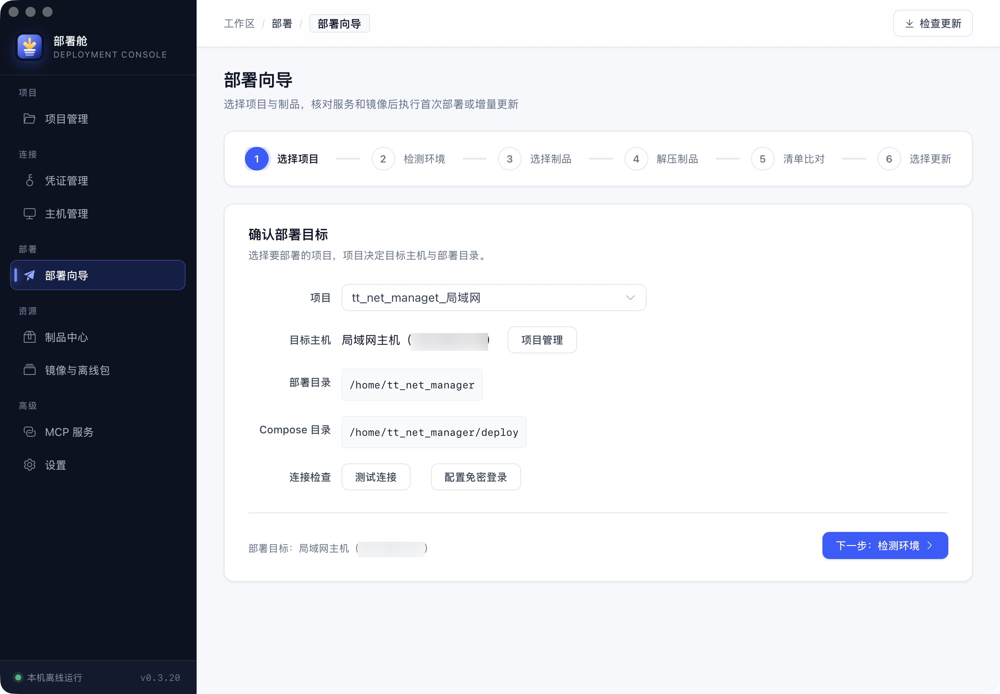

第一步确认部署目标。选择项目后，页面显示该项目绑定的主机、部署目录与 Compose 目录，并可执行「测试连接」「配置免密登录」。

更换项目会重新读取项目上下文，此前已选的制品、环境检测与比对结果都会清空，需要重新执行。

### 8.2 检测环境

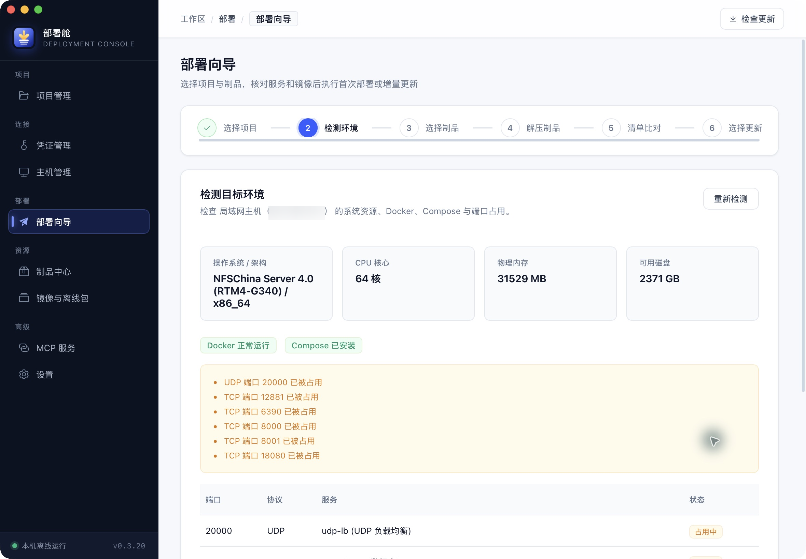

环境检测读取目标主机的系统资源、Docker、Compose 以及清单声明的服务端口。Docker 或 Compose 未就绪时不能继续；端口被占用时会列出占用情况，便于提前处理。

### 8.3 选择制品

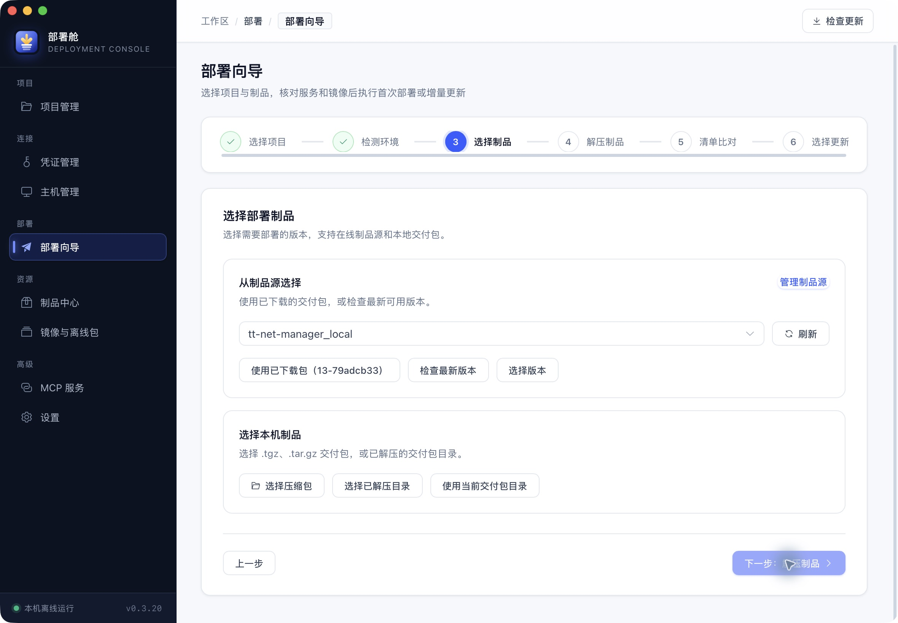

第三步提供四种输入方式：

- 从制品源选择最新版本或历史版本。
- 使用已下载到本机的交付包。
- 选择本地 `.tgz` 或 `.tar.gz` 压缩包。
- 选择已解压的目录。

这一步只确定候选，不会改动项目当前绑定的交付包。

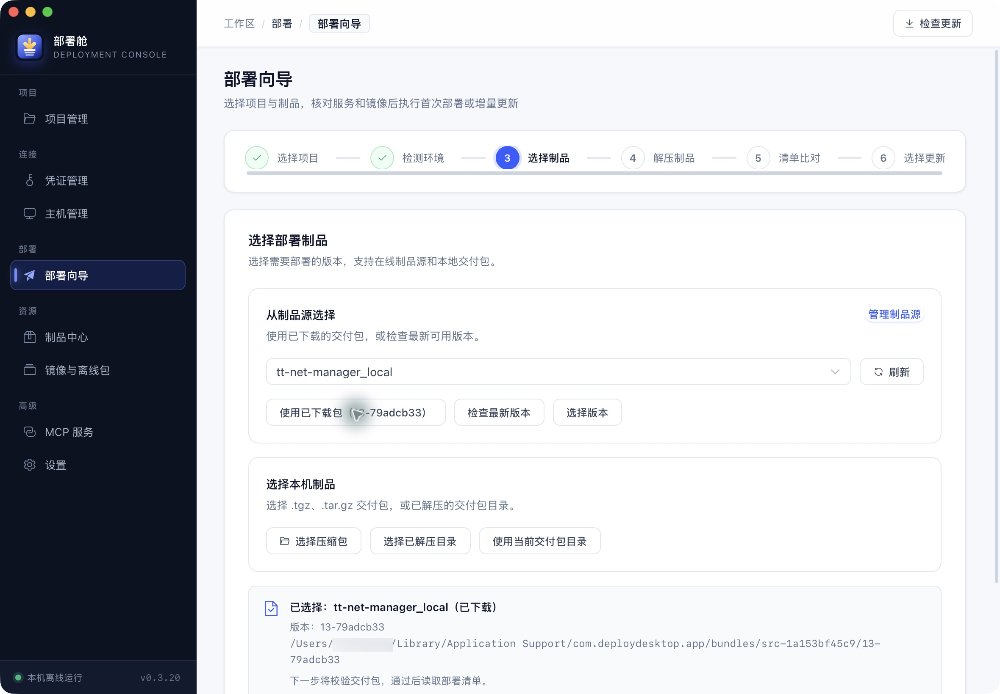

选择后页面显示包名与来源，确认无误再进入下一步。

### 8.4 解压制品

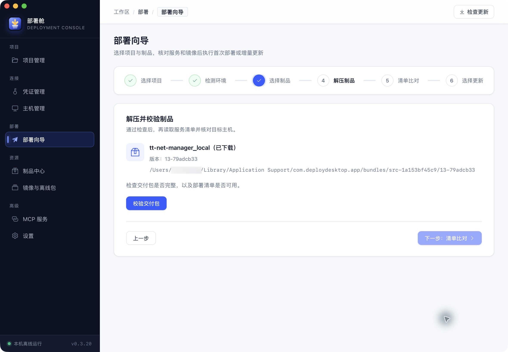

点击校验后，应用解压或读取所选制品，检查路径安全、包结构与文件摘要。

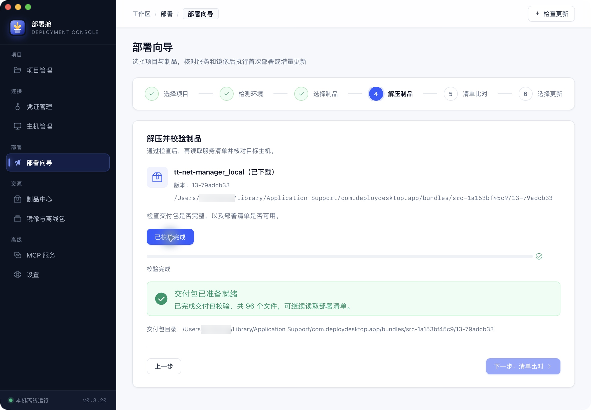

校验通过后显示文件总数与摘要结果，并把交付包绑定到当前项目。绑定同时核对产品标识，与项目记录不一致时会阻止继续。

### 8.5 清单比对

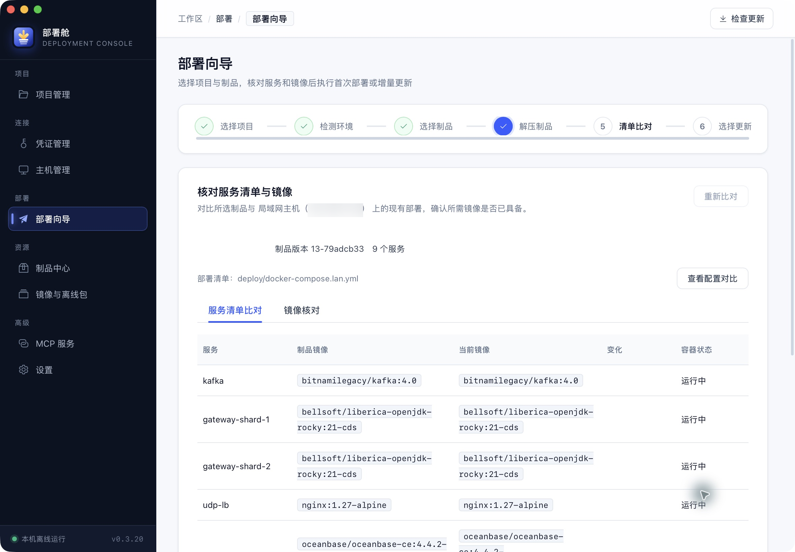

比对读取包内 Compose 清单，与目标机现有清单比较服务的新增、变化与移除，并显示两者的服务数量与版本。

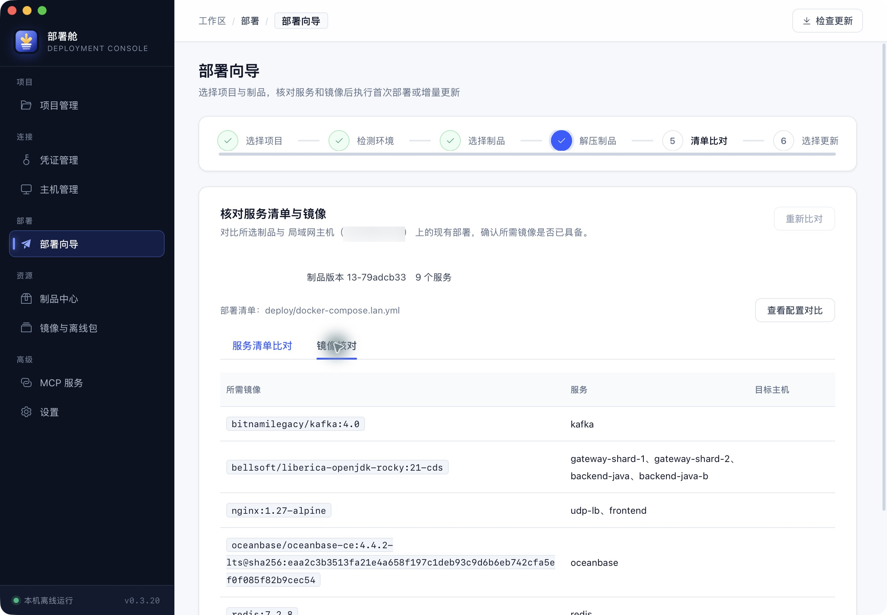

镜像按完整引用核对，带有摘要的引用不会回退为标签。离线镜像包存在不等于镜像已导入；缺失或无法确认的镜像会阻止进入执行步骤。此时可以选择本机离线介质目录，上传并导入后重新比对。

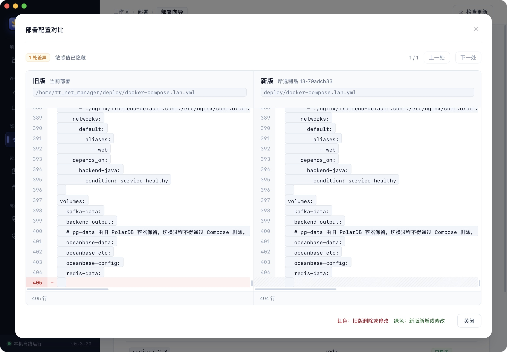

「查看配置对比」展示本次核对读取的完整文件快照：左侧为当前部署，右侧为所选制品。旧版删除或修改的行标红，新版新增或修改的行标绿，支持同步滚动与差异跳转。窗口隐藏敏感值，但变更判定仍按原始内容进行；该窗口只用于查看，不会改写配置文件。

比对结果中的环境变量、端口等配置差异属于确认信息，不要求新旧完全一致。只有勾选「部署配置」时才会替换配置文件。

### 8.6 选择更新

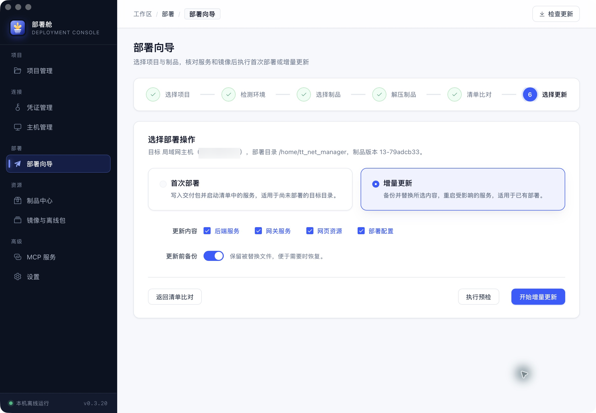

最后一步显示目标主机、部署目录与制品版本，并提供两种操作：

- 首次部署：写入交付包并启动清单中的服务，仅对空的部署目录开放。
- 增量更新：备份并替换所选内容，重启受影响的服务，仅对已有部署开放。

两者互斥：目标目录中已存在 Compose 清单时，首次部署不可选；目录为空时只提供首次部署。更新内容按交付包声明的组件勾选，示例中为后端服务、网关服务、网页资源与部署配置。

「更新前备份」默认开启，被替换的文件会保留，便于需要时恢复。取消勾选会减少磁盘占用，但失败时无法回退到旧文件。

操作按钮：

- 「返回清单比对」：回到上一步重新核对。
- 「执行预检」：执行只读检查，不替换文件、不创建备份、不重启服务。
- 「开始增量更新」或「开始首次部署」：按当前选择执行真实操作。

执行前会再次预检，并检查清单声明的服务与实际生效的清单是否一致。执行期间界面按阶段显示上传、导入与就绪检查的进度和已用时间；等待时间较长时会持续更新已等待时长。

## 九、首次部署与增量更新

### 9.1 首次部署

首次部署适用于空的部署目录，执行内容：

1. 分发交付包，按声明把产物写入安装根与部署配置目录。
2. 启动清单中的全部服务。
3. 通过 Compose 获取实际容器，检查运行与健康状态。
4. 在部署目录写入 `.deploy-desktop/deployed.json`，记录版本与已写入的产物。

首次部署不会自动导入全量 SQL，数据库迁移由应用启动时自行处理，避免覆盖已有业务数据。需要初始化数据的场景，应在部署完成后按业务要求单独导入。

部署成功前会核对实际容器状态；未运行或健康检查尚未通过时显示待确认，不会显示为成功。

### 9.2 增量更新

增量更新适用于已有部署。执行时先备份被替换的文件，再按勾选的组件替换内容，并重启受影响的服务。选择多个组件时，服务只重启一次，减少中断时间。

增量更新的边界：

- 不删除数据卷，不删除清单外的容器。
- 不隐式拉取镜像，也不在目标机构建镜像；缺失镜像需要提前准备。
- 服务差异按声明比较，移除的服务不会被自动解释为删除容器或数据。
- 更新产物前校验实际挂载位置，挂载位置与声明不一致时阻止更新。

### 9.3 失败与回退

执行阶段任一环节失败都不会继续后续步骤。开启了「更新前备份」时，被替换的文件保存在部署目录的备份目录中，可按需恢复；未开启时需要重新部署上一版本。

执行失败后应先查看「设置 → 运行日志」中的记录，确认是网络、权限、镜像还是服务启动问题，再决定重试方式。

## 十、集群监控与日志诊断

### 10.1 集群监控

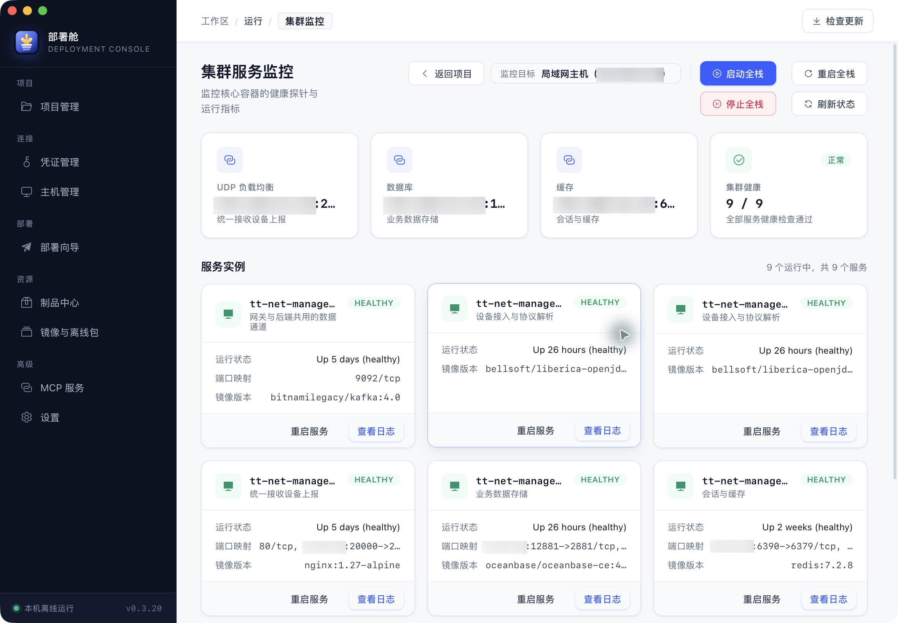

从项目卡片点击「监控」进入，监控目标固定为当前项目的主机与部署目录。页面顶部显示统一接收设备上报、数据库、缓存三项服务地址，以及集群健康比例。

服务卡片显示服务名称、职责、运行状态、端口映射与镜像版本，并提供：

- 「重启服务」：只重启该服务，影响范围最小。
- 「查看日志」：跳转到该服务的日志页面。

右上角的「启动全栈」「重启全栈」「停止全栈」作用于整套服务，应先确认业务影响；「刷新状态」用于重新采集容器状态。

健康状态来自容器的运行状态与健康检查结果，不使用容器命名推断。显示“待确认”表示容器尚未就绪，不代表部署失败。

### 10.2 日志诊断

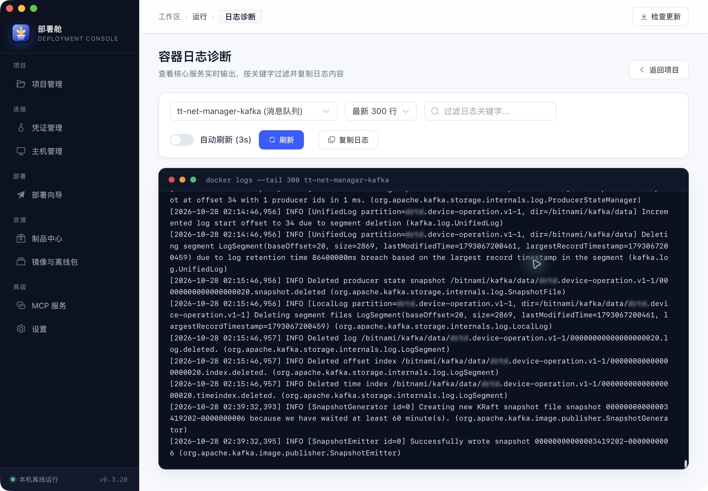

日志页面可切换服务与行数（默认最新 300 行），支持按关键字过滤、自动刷新、复制日志。

- 关键字过滤只影响当前显示，不改变容器日志。
- 「自动刷新」按固定间隔重新拉取，适合观察启动过程。
- 「复制日志」会把当前视图内容复制到剪贴板，粘贴到工单或记录前应先确认不含敏感信息。

应用自身的操作日志不在此页面，见「设置 → 运行日志」。

## 十一、镜像与离线包

### 11.1 镜像列表

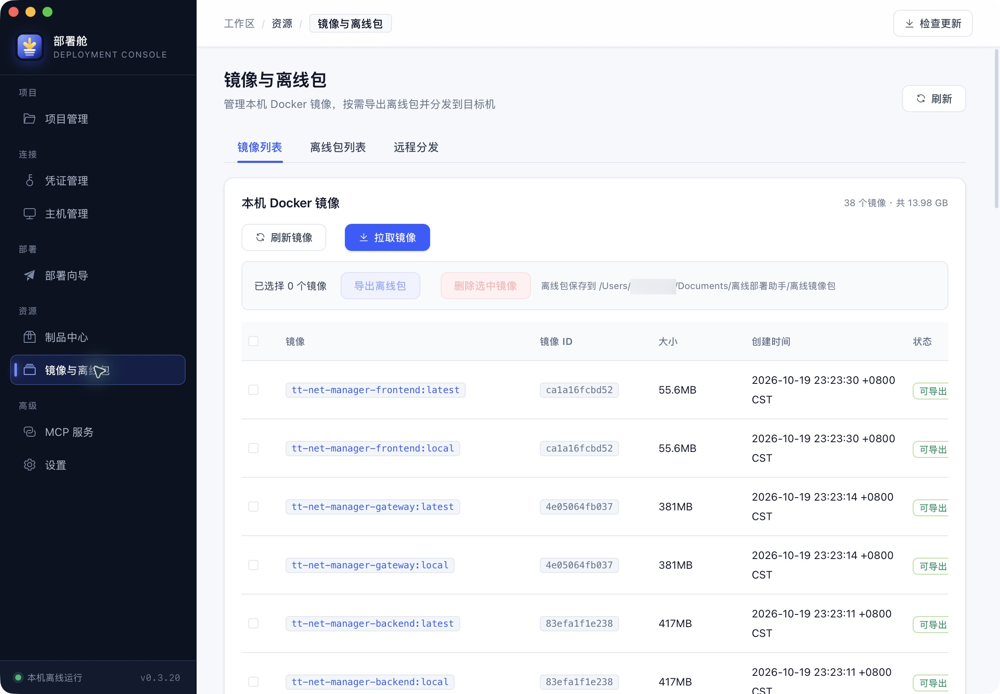

镜像列表读取本机 Docker，显示镜像名称、ID、大小、创建时间与是否可导出。顶部汇总镜像数量与总占用。

- 「拉取镜像」：按镜像地址与摘要拉取，可指定镜像源。
- 勾选镜像后「导出离线包」：生成可分发的 tar 文件。
- 「删除选中镜像」：只删除本机镜像，不影响目标机。

离线包保存目录可在本页查看与修改，导出结果会写入该目录。

### 11.2 离线包列表

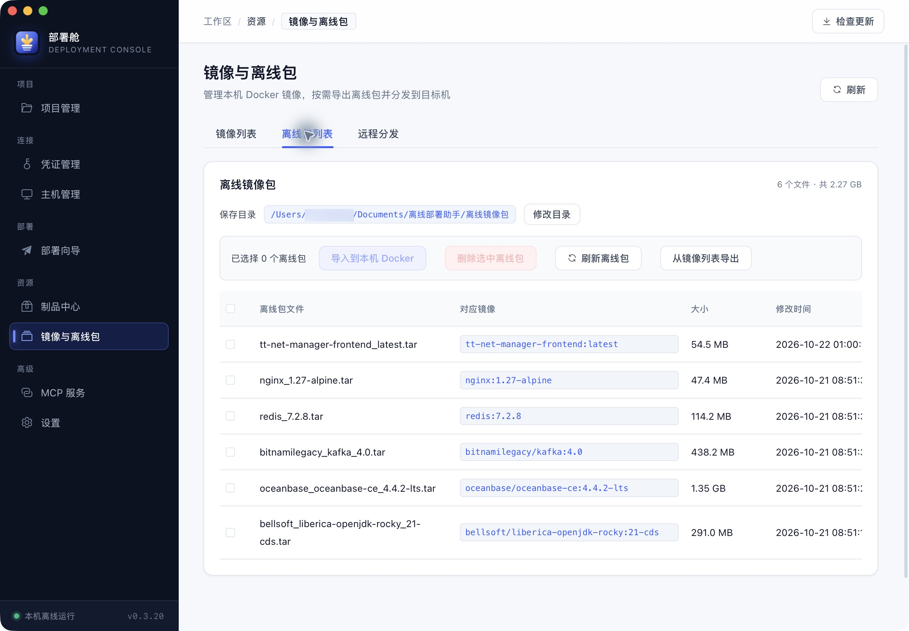

离线包列表显示文件名、对应镜像、大小与修改时间，可将选中的包导入本机 Docker，或删除本地的离线包文件。

离线环境的标准做法是：在能联网的电脑导出镜像包，复制到目标环境后，通过「镜像与离线包」导入或分发。

### 11.3 远程分发

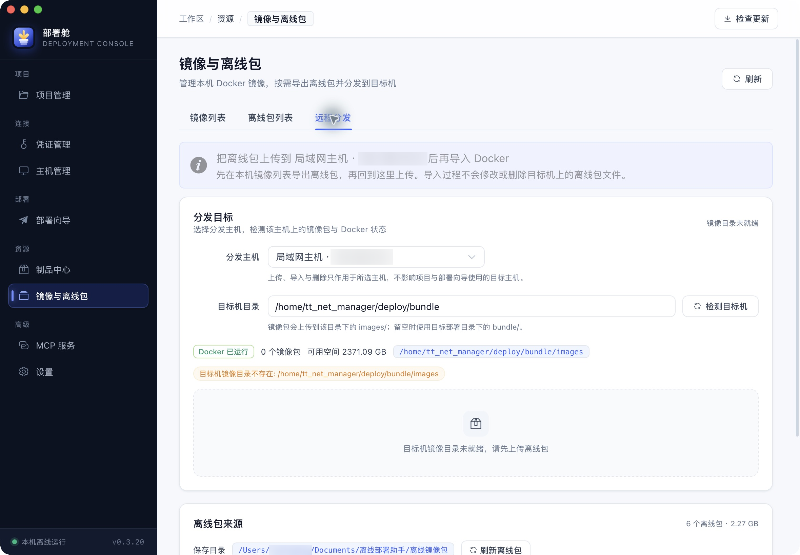

远程分发把离线包上传到目标机并导入 Docker：

1. 选择分发主机；该选择只作用于当前页面，不改变项目的目标主机。
2. 填写目标机目录，镜像包会上传到该目录下的 `images`；留空时使用目标部署目录下的 `bundle`。
3. 点击「检测目标机」确认 Docker 运行状态、镜像包数量与剩余空间。
4. 按需选择「上传缺失离线包」「覆盖上传全部」「仅导入未加载镜像」「全部重新导入」。

上传与导入逐个文件执行，可实时查看进度。导入过程不会修改或删除目标机上的离线包文件；删除只移除镜像包文件，不影响已导入的镜像。

## 十二、设置

### 12.1 制品设置

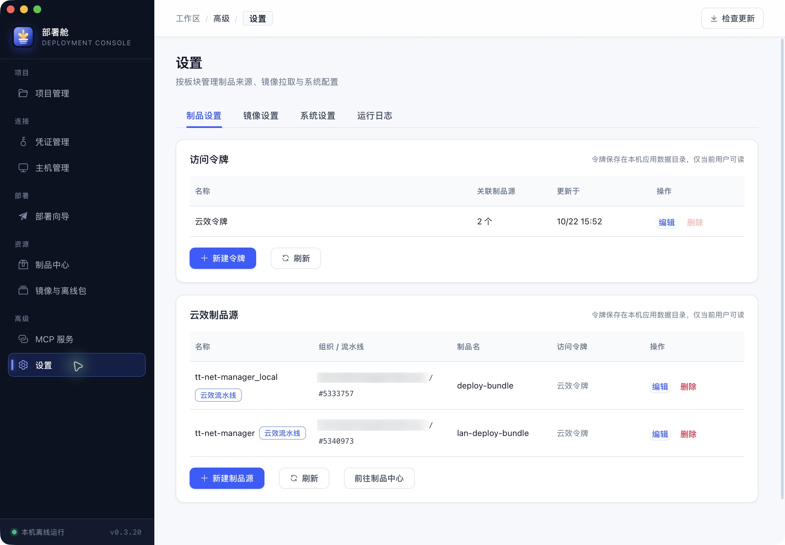

制品设置分两块：

- 访问令牌：集中保存云效个人访问令牌，可命名后供多个制品源选用。仍被引用的令牌不能删除，需要先更换。
- 云效制品源：维护组织、流水线、制品名与所选令牌，可在此新建、编辑或删除来源。

编辑令牌时内容留空表示只修改名称，不会覆盖已保存的令牌。

### 12.2 镜像设置

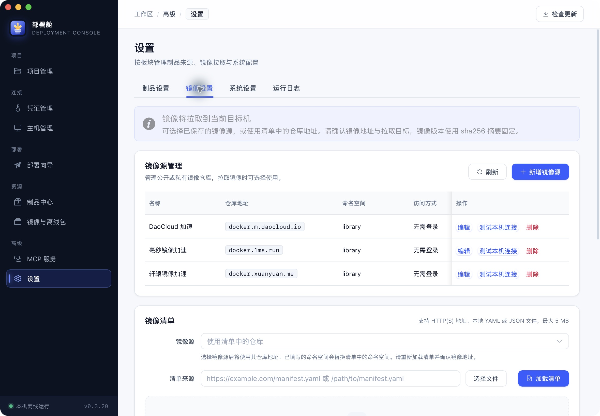

镜像设置用于管理镜像仓库与镜像清单：

- 镜像源：保存公开或私有仓库地址、命名空间与访问方式，可测试本机连接。
- 镜像清单：支持 HTTP(S) 地址、本地 YAML 或 JSON 文件，最大 5 MB。加载前选择镜像源时，仓库地址会被替换，需要重新确认镜像地址。

拉取镜像时使用 `sha256` 摘要固定版本，仓库中标签被覆盖不会影响已部署的服务。

### 12.3 系统设置

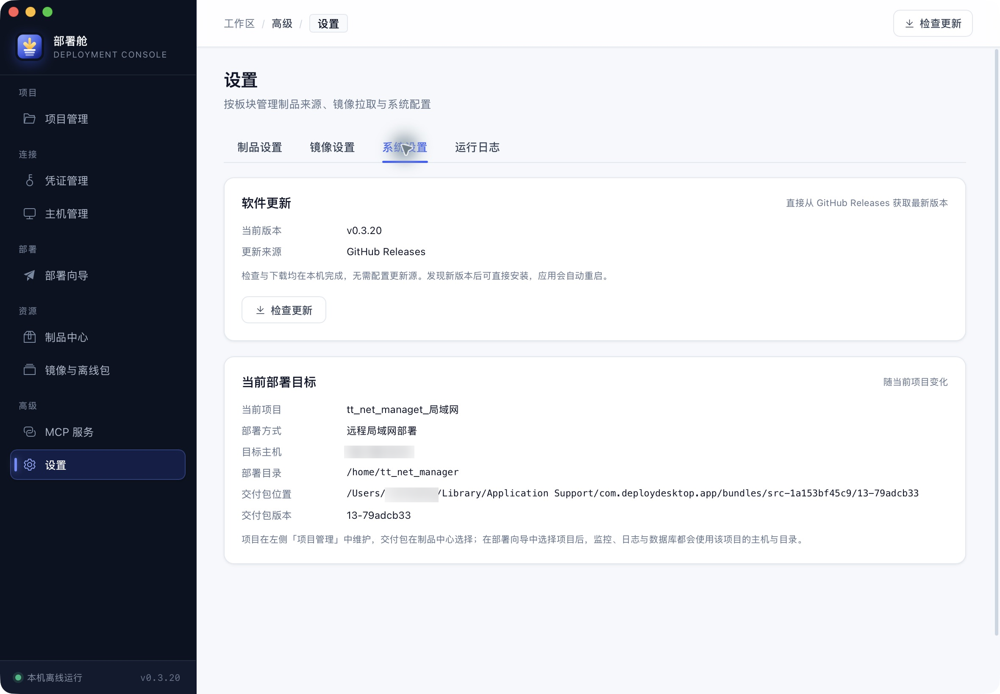

系统设置包含两部分：

- 软件更新：显示当前版本与更新来源，点击「检查更新」获取新版本并安装，安装完成后应用自动重启。
- 当前部署目标：汇总当前项目的名称、部署方式、目标主机、部署目录、交付包位置与版本。此处只读，修改请在「项目管理」或「制品中心」完成。

### 12.4 运行日志

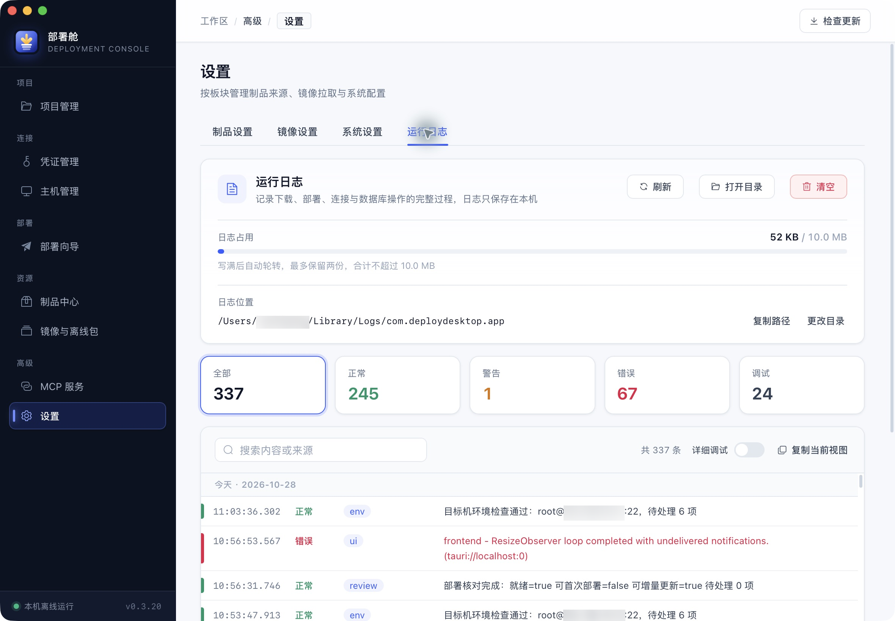

运行日志记录下载、解包、校验、部署、连接、环境检查与数据库导入等操作的过程与结果。

- 顶部显示日志占用与保存位置，可「打开目录」或「更改目录」；更改后立即生效，原有日志留在原位。
- 分类卡片按全部、正常、警告、错误、调试统计条数，点击可筛选。
- 支持按内容或来源搜索，并复制当前视图。
- 单个文件上限 5 MB，超出后轮转，两个文件合计不超过 10 MB。

界面操作失败时也会追加一条记录，是排查问题的第一入口。

## 十三、MCP 服务

MCP 服务让支持 MCP 的 AI 助理读取项目、主机与交付包信息，并调用部署与运维能力。服务由 AI 助理启动，部署舱不代为启动，连接状态在 AI 助理中查看。

### 13.1 配置指南

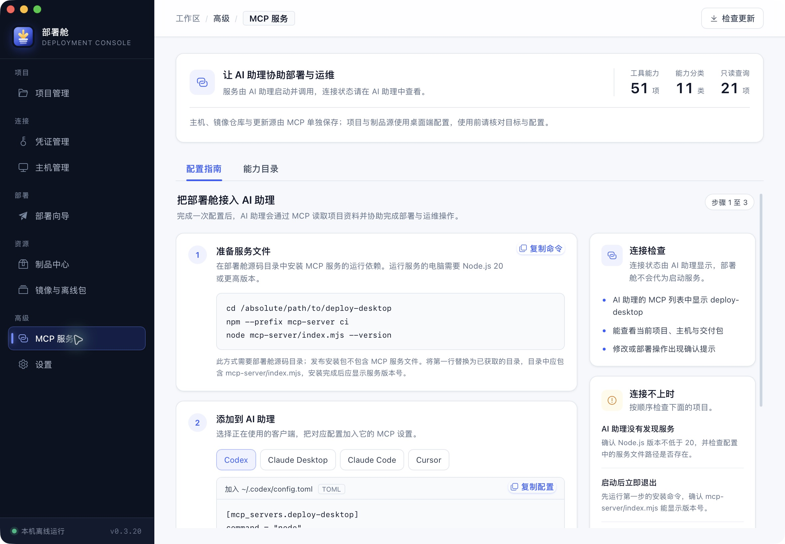

配置分为三步：

1. 准备服务文件：在部署舱源码目录安装运行依赖，运行环境需要 Node.js 20 或更高版本，可用 `node mcp-server/index.mjs --version` 确认。
2. 添加到 AI 助理：选择 Codex、Claude Desktop、Claude Code 或 Cursor，复制对应配置并合并到该客户端的 MCP 设置中。
3. 重启并验证连接：完全退出并重新打开 AI 助理，发送页面提供的检查请求，确认能返回项目与部署目标。

发布安装包暂不包含 MCP 服务文件，因此第 1 步需要源码目录。主机、镜像仓库与更新源由 MCP 单独保存，项目与制品源使用桌面端配置，使用前应核对目标。

### 13.2 能力目录

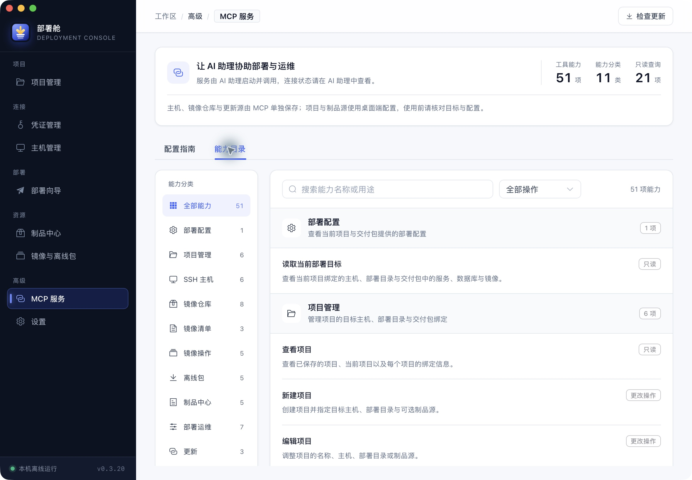

能力目录按分类列出 51 项能力，可用名称或用途搜索，也可按操作类型筛选。每项能力标注操作属性：

- 只读：仅查询，例如查看项目、读取服务日志。
- 更改操作：会修改配置或目标机状态。
- 需确认：执行前需要显式确认，例如删除主机配置、导入数据库、离线安装 Docker。

## 十四、常见问题

**目标目录只有部分内容，首次部署不可选**

说明目标目录已存在 Compose 清单，被判定为已有部署。请确认该目录是否为上一次部署的残留，必要时清理后再执行首次部署，或直接使用增量更新。

**环境检测提示 Docker 或 Compose 未就绪**

确认目标机的 Docker 服务已启动并允许当前用户访问；远程主机还需要具备 Compose。离线环境可按需要先安装 Docker，再重新检测。

**清单比对提示镜像缺失**

按提示在目标机准备镜像：联网时使用镜像设置拉取，离线时导出镜像包并通过「远程分发」上传导入，然后重新比对。离线包文件存在但未导入时仍会被判定为缺失。

**端口被占用无法继续**

在主机状态页查看占用来源。若由本项目已有容器占用属于正常；若由其他程序占用，需要先停止或调整端口后再部署。

**更新后服务显示待确认**

表示容器尚未通过健康检查。可先查看日志确认启动过程，稍后点击「刷新状态」；持续未通过时应按日志排查配置、依赖或数据问题。

**删除项目后目标机上的文件还在**

删除项目只移除记录，不删除交付包缓存与目标机文件。需要清理目标机时请单独操作。

**应用提示有新版本但安装失败**

确认网络可以访问 GitHub Releases，安装包会校验签名。下载失败可稍后重试，或手动从发布页面下载对应平台的安装包。

## 十五、数据与安全

- SSH 私钥保留在本机原位置，应用只记录路径。
- 仓库密码、SSH 初始密码与云效令牌保存在本机独立凭据文件中，文件权限为 0600，未做额外加密，依赖操作系统账户保护。不要在共享账户或不受信任的电脑上保存生产密码。
- 交付包仅允许通过 HTTPS 下载，云效来源额外限制域名；下载与解包会检查摘要、路径安全与包结构。
- 部署执行不采集遥测，不上传部署数据。
- 交付包、制品源与部署记录中可能包含内部地址与业务信息，对外分享截图或日志前应先脱敏。

## 附录 A 配置目录与文件

| 平台 | 应用配置目录 |
| --- | --- |
| macOS | `~/Library/Application Support/com.deploydesktop.app` |
| Windows | `%APPDATA%\com.deploydesktop.app` |
| Linux | `~/.config/com.deploydesktop.app` |

| 文件或目录 | 内容 |
| --- | --- |
| `projects.json` | 项目列表与当前项目 |
| `connections.json` | 凭证与主机信息，不含密码 |
| `connection-secrets.json` | 凭证的初始 SSH 密码 |
| `artifact-sources.json` | 制品源列表与所选令牌标识 |
| `artifact-tokens.json` | 制品源访问令牌内容 |
| `artifact-releases-cache.json` | 最近一次成功获取的版本列表 |
| `bundles/<sourceId>/<version>/` | 解包后的交付包 |
| `log-settings.json` | 自定义运行日志目录 |

部署成功后，目标机部署目录下会写入 `.deploy-desktop/deployed.json`，记录版本与已写入的产物；该文件用于远程状态展示，缺失时只显示容器状态。

## 附录 B 版本记录

| 版本 | 日期 | 说明 |
| --- | --- | --- |
| 0.3.20 | 2026-10-28 | 新增本使用说明书；镜像预检兼容 Docker 27 的 RepoDigests 解析 |
